# Prometheus + Grafana Linux Server Monitoring Lab

A reproducible monitoring stack for one Ubuntu server: **Node Exporter** exposes host metrics, **Prometheus** scrapes, stores and alerts on them, and **Grafana** shows a provisioned dashboard. Everything starts with one `docker compose up`.

> This is a **local lab**, not a monitored cloud VM.

## Architecture
```
Ubuntu VM -> Node Exporter :9100 -> Prometheus :9090 (scrape 15s, rules) -> Grafana :3000
```
Details: [documentation/architecture.md](documentation/architecture.md)

## Quick start (Ubuntu Server VM with Docker)
```bash
git clone https://github.com/<your-user>/prometheus-grafana-cloud-monitoring
cd prometheus-grafana-cloud-monitoring/docker
cp .env.example .env        # then edit GRAFANA_ADMIN_PASSWORD
docker compose up -d
```
Open Grafana at `http://<vm-ip>:3000` (user `admin`), dashboard **TechCorp - Linux Server Monitoring Dashboard**. Prometheus: `:9090/targets`. Full steps: [installation-guide](documentation/installation-guide.md).

## Dashboard panels
Server status, uptime, CPU / memory / disk gauges, CPU and memory history, network in/out, system load (1/5/15 m), disk I/O. Queries are explained in [grafana-dashboard.md](documentation/grafana-dashboard.md).

## Alerts
`ExporterDown`, `HighCPUUsage`, `HighMemoryUsage`, `LowDiskSpace`, `HighSystemLoad` in `prometheus/alerts.yml`. They are evaluated and visible in Prometheus (Alerts page). Notification routing (Alertmanager) is **not** included yet.

## Failure tests
`scripts/cpu-load.sh`, `scripts/memory-load.sh`, `scripts/exporter-failure-test.sh` - see [troubleshooting.md](documentation/troubleshooting.md).


## Progress checklist
- [x] Ubuntu VM + Docker installed
- [x] Stack running, targets UP
- [x] Dashboard verified with real data
- [x] CPU load test captured
- [x] Exporter failure/recovery captured
- [x] Alerts seen firing in Prometheus
- [x] Screenshots added

## Screenshots

**Prometheus**

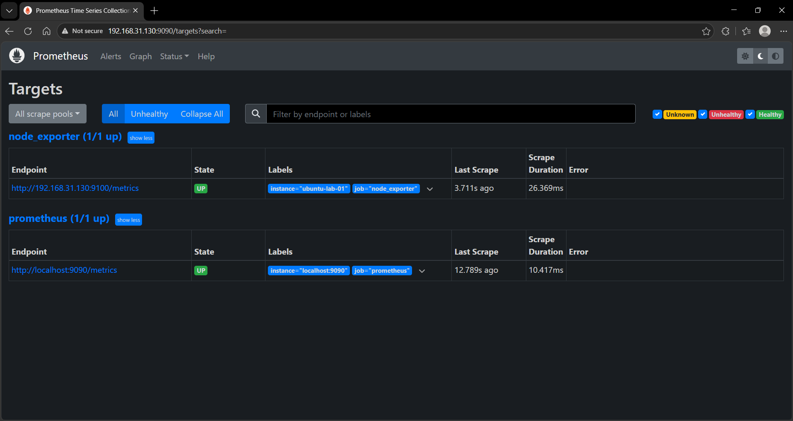

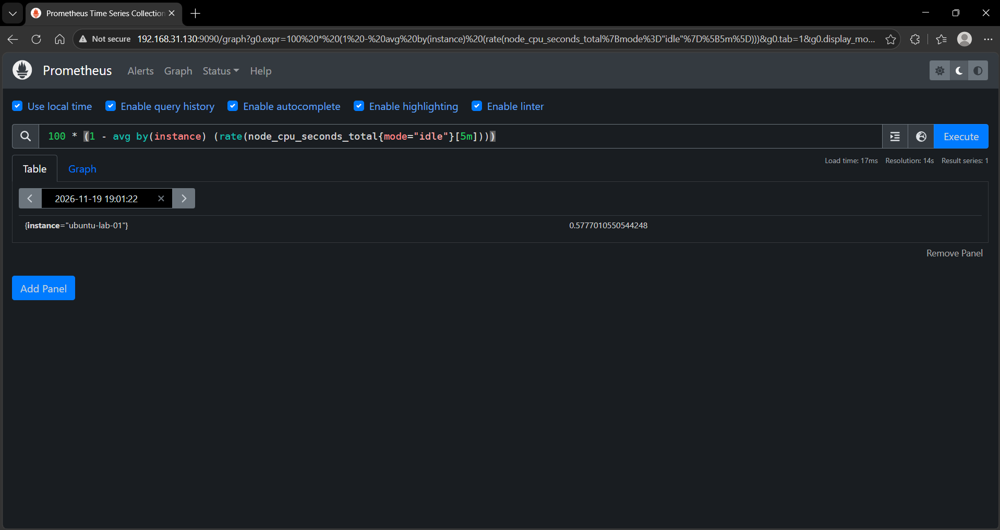

**Grafana**

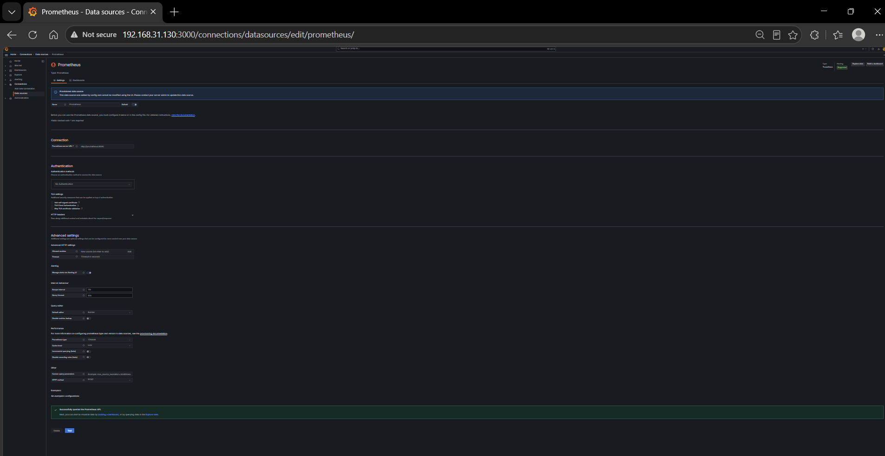

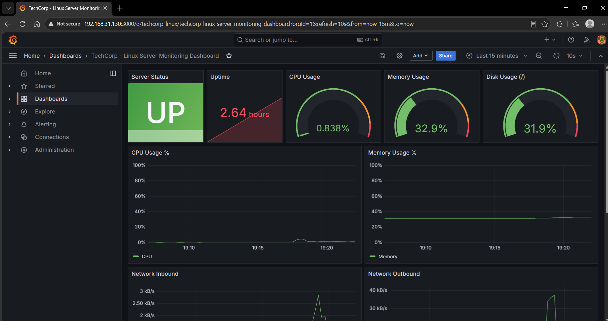

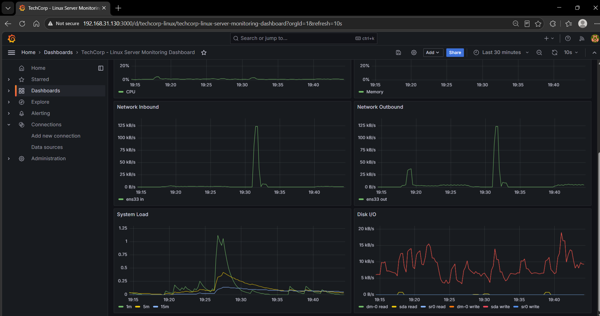

**Failure testing**

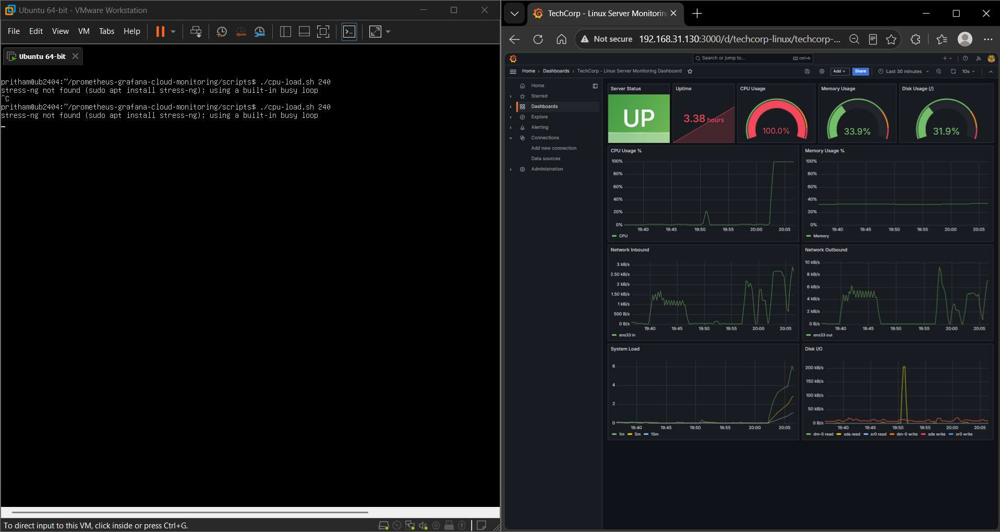

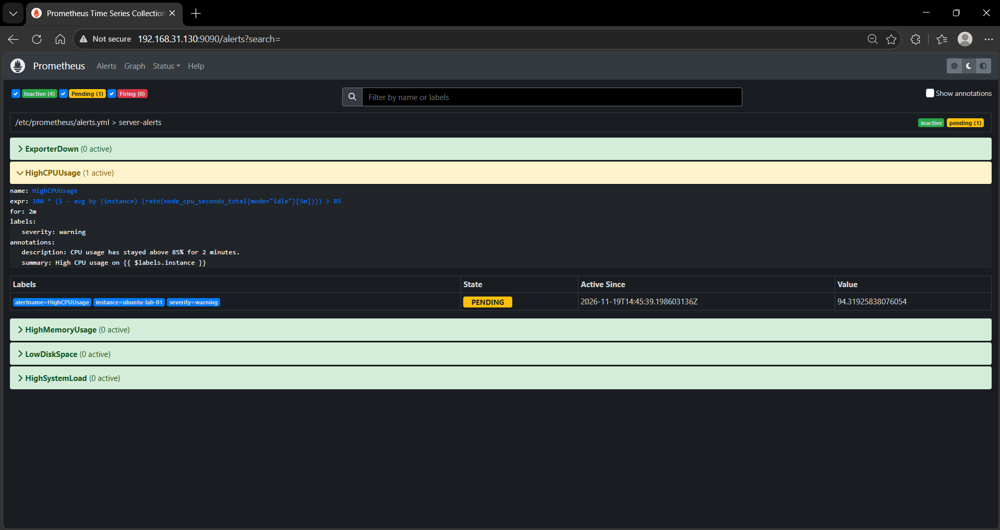

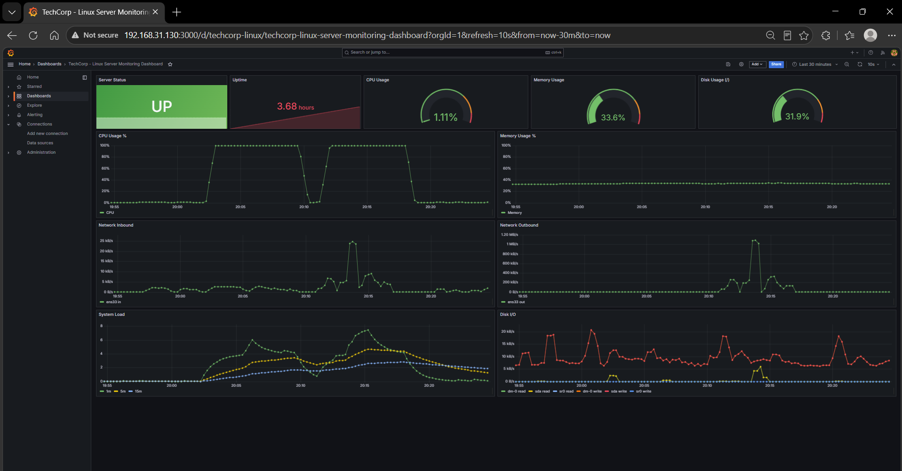

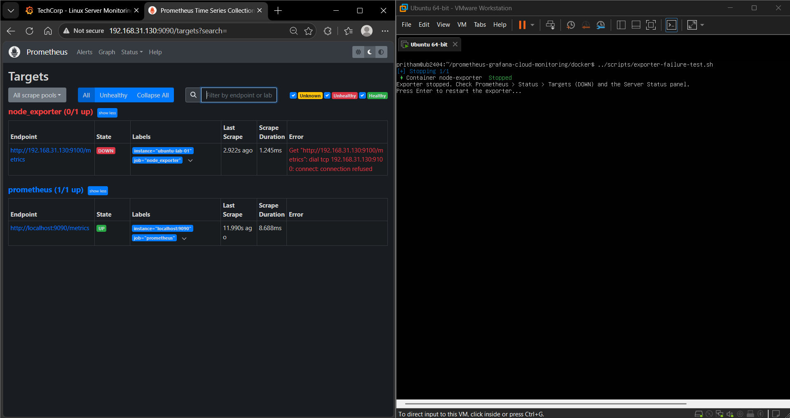

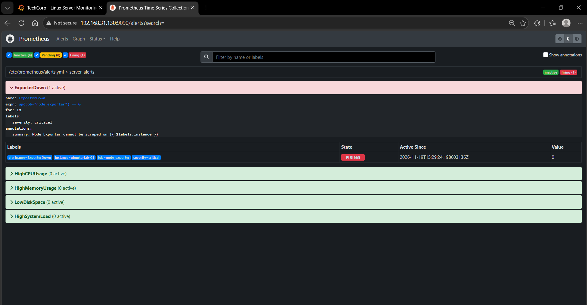

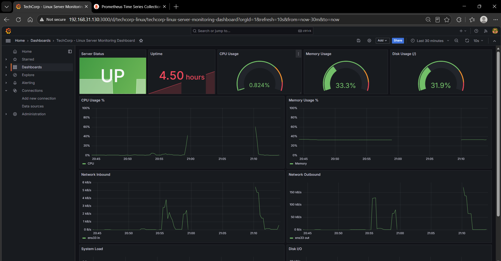

## Security
No secrets are committed (`docker/.env` is git-ignored). Ports bind to `127.0.0.1` by default. Do not expose Grafana, Prometheus or Node Exporter to the internet without authentication and network restrictions.

## Limitations / next steps
Single server, no Alertmanager, no log monitoring. Next: a second Linux target, Alertmanager notifications, a cloud VM.

